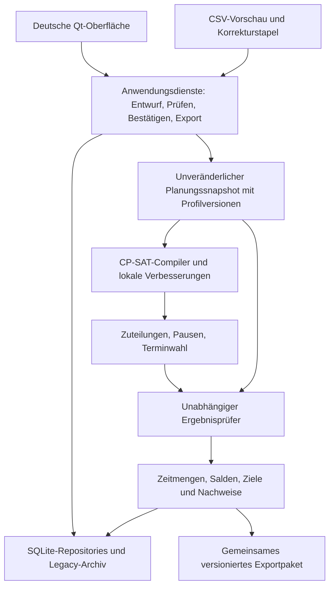

# V2 – Architektur, Migration und prüfbare Etappen

**Aktualisierung 10.11.2026:** Der ausdrückliche Folgeauftrag ersetzt ab Version 0.3.0 die alte Oberfläche durch die V2-Hauptanwendung. Es gibt keinen zusätzlichen Testbereich mehr. Dienstrechte werden als zeitgültige **Ausschlüsse** bedient; gespeicherte Rechte bleiben durch verlustfreie Komplementdarstellung erhalten. Zeitmengen erscheinen in Stunden, intern bleiben Minuten/Brüche. Neue Monate erhalten den Standardkatalog und die bestimmten Tagesmuster automatisch. Dieser Oberflächenauftrag entscheidet keine offenen Fach-/Tarifprofile und autorisiert keine Migration echter Altdateien. Historische Aussagen zum parallelen Altbetrieb weiter unten beschreiben den vorherigen Stand. Details: [Bedienung](V2_BEDIENUNG.md), [Fortschritt](V2_FORTSCHRITT.md).

Aktueller Implementierungs- und Prüfstand: [Fortschritt](V2_FORTSCHRITT.md),
[Zuordnung aller 125 Abnahmefälle](V2_ABNAHMESTATUS.md) und
[Bedienung des technischen Prüfbereichs](V2_BEDIENUNG.md). Die nachfolgende
Etappe-A-Spezifikation bleibt die fachliche Grundlage; Testprofile ersetzen sie nicht.

Stand 09.11.2026, Etappe A. Entwurf auf Basis der
[Bestandsaufnahme](V2_BESTANDSAUFNAHME.md), verbindlich hinsichtlich der
[Fachregeln](V2_FACHREGELN.md), abhängig von den bezeichneten
[Profilentscheidungen](V2_OFFENE_FRAGEN.md). Hier wird noch kein produktiver
Planungskern, kein neues SQLite-Schema und keine echte Benutzerdatenbank umgebaut.

## 1. Technologie und Modulgrenzen

Python 3.12, PySide6/Qt Widgets, SQLite und OR-Tools CP-SAT bleiben. Eine neue
Solverbibliothek beseitigt die fachlichen Altannahmen nicht. Kleine Python-
Wertobjekte benötigen kein ORM und kein Web-Frontend. `zoneinfo`, `datetime`,
`Decimal`/`Fraction`, `sqlite3`, `csv` und `json` genügen für große Teile.
Für eigenständige Windows-Pakete braucht V2 zusätzlich mitgelieferte, festgelegte
IANA-Zeitzonendaten, z. B. das offizielle Python-Paket `tzdata`. Nicht auf zufällige
Systemdaten oder Onlineabrufe im Desktopbetrieb vertrauen. Abhängigkeit/Version
erst im entsprechenden Implementierungsschritt einführen und nativ paketieren.

Vorgeschlagener neuer Namensraum `dienstplan/v2/`, ohne Umbenennung der funktionierenden
Legacy-Module. Keine neue parallele Anwendung und kein neues Repository.

| Modulgruppe | Aufgabe / Grenze |
| --- | --- |
| `domain/people`, `contracts`, `catalog`, `events` | Qt-/SQL-/Solver-freie Wertobjekte, zeitgültige Rechte und Vorlagen |
| `time/intervals`, `calendar`, `segments` | Wien ↔ UTC, halboffene Intervalle, Tages-/Wochen-/Feiertagsschnitte, echte Pausen |
| `profiles/` | Versionierte betriebliche/rechtliche/Soll-/Zulagenprofile, Quellen und Freigabestatus |
| `planning/snapshot`, `horizon`, `candidates` | Vollständige Eingabe, bekannte/unbekannte Randdaten, gekoppelte Termin-/Personenkandidaten |
| `planning/cp_constraints`, `objectives`, `search` | CP-SAT-Modell, Stufen, Hint-/Abbruch-/Zeitbudget und größere Nachbarschaften |
| `validation/` | Direkte Ergebnisregeln und Ursachen, ohne Zugriff auf Solver-Hilfsvariablen |
| `accounting/` | Physische Arbeit, Monatsgutschrift, Urlaub, Nacht/Sonntag/Feiertag, Salden und separate Fairness |
| `persistence/legacy`, `repositories`, `migrations` | Nur SQLite-/JSON-Zugriff; unveränderte Legacy-Ansicht und additive V2-Daten |
| `application/` | Transaktionen, Revisionsprüfung, Importübernahme, manuelle Änderung, Bestätigung und Export |
| `ui/` / `io/` | Ansichten und Dateiformate; keine zweite Kopie fachlicher Validierung |

Für die Übergangszeit kann das heutige `ui.py` unverändert Legacy bedienen.
V2-Ansichten werden über die Anwendungsdienste angebunden, nicht durch zusätzliche
`if shift_id == ...` in jeder alten UI-/Speicher-/Solverfunktion.

## 2. Fachobjekte und gespeicherte Fakten

Alle IDs stabil, Zeiten minutengenau, Intervalle technisch ende-exklusiv.
Dezimalwerte und exakte Anteile als Dezimaltext bzw. Zähler/Nenner speichern,
niemals mittels SQLite-`REAL` als maßgebliche Vertrags-/Gutschriftwerte.

| Objekt | Wesentliche Felder / Invarianten |
| --- | --- |
| `Person` | Bestehende `employee_id`, Anzeigename; keine monatlich neuen Personen-IDs |
| `EmploymentInterval` | Person, erster/letzter Beschäftigungstag, daraus eindeutige UTC-Grenzen; gesamter Dienst im Intervall |
| `ContractVersion` | Person, Gültigkeit, exakte Wochenstunden, Bezugs-/Durchrechnungsprofil; keine ungeklärten Lücken/überlappenden Vertragsversionen |
| `EligibilityVersion` | Person, Dienstklassen, Gültigkeit, Führerschein-/Qualifikationsfakten; Außendienstprofil mit gesondert erlaubten T/TS |
| `ServiceTemplateVersion` | Kürzel, Zeitfenster, Folgetag, Variante, Pausenregel und explizite Veranstaltungs-Erfüllung; R hat zwei getrennte Vorlagenvarianten |
| `Event` | Stabile Veranstaltung/operativer Anlass, Datum oder Kandidatenmenge, Quelle einer Terminfixierung, T/TS-Komponenten, erforderliche/ausgenommene Teilnahme |
| `CoverageRequirement` | Event, operative Rolle, Anzahl verschiedener Personen, zulässige Blockvarianten; z. B. ein Außendienstbedarf W17 oder W16 |
| `WeeklyQuota` | Dienstfamilie, eindeutiger Wochen-/Saisonbezug F06, Sollanzahl, Besitzer und Randreservierungen; keine zweite Monatskopie derselben Quote |
| `DutyBlock` / `Assignment` | Vorlage/Variante, Person, lokales Startdatum, konkrete UTC-Grenzen, feste Person gesondert von festem Datum, Begründung für W16 |
| `WorkSegment` / `BreakSegment` | Konkrete echte Intervalle innerhalb eines Blocks; nicht überlappend, vollständige Zerlegung der Anwesenheit; Pause genau einmal |
| `ParticipationLink` | Explizite Erfüllung T oder TS durch erlaubten Block; kein zweiter Zeit-/Besetzungseintrag |
| `Absence` / `LeaveCreditDay` | Abwesenheitstyp/Zeitraum getrennt von expliziter Gutschrifttagesmenge; eindeutige Person/Datum-Gutschrift |
| `Wish` | Stabile `wish_id`, Typ Einzeltag/Wochenende, Zeitraum, Monat, Status, Import-Identität; ein Wunsch trotz mehrerer Verletzungen einmal |
| `CorrectionBatch` / `CorrectionEntry` | Originaleingabe, Zeilennummer, Fehler, Korrekturstatus; getrennt von aktiven Wünschen und ihren Budgets |
| `MonthAccount` | `B`, individuelles `E` (neu 0), exaktes/gerundetes `S/G`, Profilbezüge; Anfangssaldo nicht beim Nullziel löschen |
| `PolicyProfileVersion` | Wirksamkeit, Anwendbarkeit, bestätigte Parameter, Quellen/Hash/Fundstellen; nicht bestätigte Pflichtfelder bleiben erkennbar offen |
| `PlanRevision` | ID, Eingabefingerprint, Regel-/Katalog-/tzdb-Versionen, Zuteilungen/Pausen, Prüfergebnis, Zielwerte und stufenbezogene Beweise |
| `Confirmation` | Verweis auf eine unveränderliche Revision und eingefrorene Roh-/Sollhistorie; idempotent je Bestätigungsrevision |

Arbeitstag/Freitag/Wochenende nicht aus aufsummierten bezahlten Minuten ableiten.
Für normale Arbeitsblöcke belegt die tatsächliche Dienstanwesenheit inklusive
einer Randpause den berührten Tag; Gutschrift allein nie. Separat berechnen:
tatsächliche Arbeitsminuten, Dienstbelegung, Wochenend-Zählausnahme und
Wochenendwunsch-Erfüllung. R braucht seine eigene bestätigte Dienstformbewertung.

## 3. Zeit- und Veranstaltungsmodell

Eine lokale Eingabe wird mit `Europe/Vienna` auf Existenz/Eindeutigkeit geprüft.
UTC-Instanten für Ruhe und Überlappung verwenden; reine Subtraktion zweier
`datetime` mit derselben lokalen `tzinfo` ist kein ausreichender DST-Dauernachweis.
Beide Herbst-`fold`-Varianten müssen per UTC-Rückkonvertierung unterscheidbar sein;
eine übersprungene Frühlingszeit ist keine gültige Variante.

Aus dem Block und seiner echten Pause wird Arbeit durch Intervall-Differenz erzeugt.
Gemeinsame zulässige Tätigkeit zählt physisch einmal; ihre Referenzen erfüllen
gegebenenfalls Teilnahme. Zufällig überlappende unabhängige Dienste bleiben ein
Konflikt. Eine vorhandene T-Veranstaltung wird an TS-Tagen in eine TS-Veranstaltung
mit enthaltenem T-Kern überführt. KCT10/KCT/TW erfüllen diesen Kern ausdrücklich,
LB dort die volle TS; BK ist ausgenommen. Kein zusätzliches T-Intervall in der
personenbezogenen Zuteilung der bereits erfüllenden Blöcke anlegen.

Pausenkandidaten aus bestätigten zulässigen Zeitfenstern bilden. Für KCT10/TW/KCT
muss der komplette T-Kern arbeitsseitig erhalten bleiben; bei LB am TS-Tag das
komplette TS-Intervall. Eine betrieblich bestätigte Vertretung ist eine echte
Ressource mit eigener Berechtigung und Ein-Block-Prüfung, kein impliziter Platzhalter.
Die gesamte Anwesenheit ist weiterhin der Dienstblock für Ruhe und Startdatumsregel.

Die Zeitfunktionen liefern kalenderbezogene UTC-Teilintervalle für jeden lokalen
Tag/Monat/Jahreswechsel und jedes Nachtfenster. Feiertag und Sonntag können dieselbe
Minute markieren, ohne physische Arbeit zu duplizieren. Erst die Tarifkonfiguration
entscheidet über Geld und Kumulation. Monatliche Stundenbuchung folgt F04;
physische Teilmengen bleiben unabhängig davon reproduzierbar.

## 4. Horizont und gekoppelte Terminwahl

Der Horizont wird nach Regelabhängigkeiten geschlossen, nicht pauschal am
Monatsersten/-letzten abgeschnitten: vollständige betroffene WL/BK-Wochen,
berührte Wochenenden mit unmittelbar vorherigem Mo–Fr, mögliche Fünf-Tage-Folgen
einschließlich sechsten Prüftags und tatsächliche Ruhe-/Mitternachtsgrenzen.
Prüfpflichtige Fenster mit Beteiligung des ausgewählten Monats vollständig erfassen;
nicht eine unendliche Prüfung aller nur ergänzend berührten Randtage behaupten.

Randwerte tragen Herkunft und Status: bestätigte Zuteilung, ausdrücklich bekannte
Arbeitsfreiheit, verfügbarer Entwurf, ergänzender Vorschlag oder unbekannt.
Bestätigte Vergangenheit wird nicht verschoben. Ein fehlender Folgemonat ist kein
Beleg für Freizeit. Ein ergänzender Vorschlag belegt höchstens Machbarkeit unter
dieser Randannahme; ohne belastbare Festlegung bleibt der Nachweis bedingt.
Beim Übernehmen nur den gewählten Monat und die ausgewiesenen Quoten-/Randbindungen
speichern, nicht heimlich den Folgemonatsplan bestätigen oder historisieren.

Für WL/BK werden mögliche Datumskandidaten und Personenzuteilungen **im selben Modell**
verbunden, z. B. `y(event,date)`, `x(event,date,person)` mit `x <= y`.
Exakte Quoten nach F06, verschiedene WL-Daten und Ausschluss nach F07. Festgelegte
Daten beschränken `y`, feste Personen zusätzlich `x`. Ein Kandidat darf nicht
nachträglich durch einen unabhängigen „Tagegenerator“ gegen Ruheregeln verschoben werden.

W17/W16 teilen eine Bedarf-ID und eine Variantenwahl; beide zusammen verdoppeln
den Bedarf nicht. Bei offenen Plätzen bleibt die gewählte Dienstvariante mit
Begründung sichtbar. T/TS-Teilnahme ist bedingt aus geeigneten Blöcken oder einem
eigenen Teilnahmeblock; ungeeignete Überlappung erzeugt keine Teilnahmevariable.

## 5. Solver, Ergebnisprüfung und Suche

Für kleine erste Machbarkeitsfälle genügen boolesche Kandidatenvariablen und
vorbereitete Konfliktkanten. Optionale Intervalle und diskrete oder begrenzte
Pausenstartvariablen ergänzen sie, sobald echte Vertretungsabdeckung nötig ist.
Keine pauschale 15-Minuten-Rundung: Grenzfälle von einer Minute sind verbindlich.
Große Produkte aus allen Personen × Terminen × möglichen Pausen vermeiden;
berechtigte Kandidaten und zulässige Pausenfenster vorab begrenzen, ohne fachlich
zulässige Lösungen unbegründet auszuschließen.

Harte Compilerbedingungen umfassen insbesondere Beschäftigung/Rechte, Urlaub,
Ein-Block-Startdatum, Überschneidung, reale Ruhe, fünf belegte Arbeitstage,
Wochenendquote, Vorwochen-Freipaar und die nach Profil bestätigten Quoten/Fixierungen.
Operative Besetzung erlaubt explizite offene Plätze in einem diagnostischen
Teilplan. Exakte Veranstaltungshäufigkeit ist davon getrennt: ein erzeugter WL-
Termin ohne Personal ist offen, kein still gestrichener Termin. Widersprüchliche
feste Datums-/Personenbedingungen werden vorab bzw. als Konflikt diagnostiziert.

Der zweite Prüfer erhält ausschließlich Snapshot und konkretes Ergebnis mit
Pausen/Terminen. Er rekonstruiert direkt Mengen, Zeitfenster, Personenrechte,
Arbeitstagsläufe, Wochenenden/Freipaare, Veranstaltungserfüllung, Quoten,
Stunden/Gutschriften und relevante Wünsche. Keine Übernahme von CP-Flags als Beleg.
Geprüfte Kalender-/Intervallfunktionen dürfen gemeinsam genutzt werden; separate
Constraint- und Ergebnislogik ermöglichen Gegenproben mittels Ergebnismanipulation.

Jede Verletzung enthält Regel-ID, Person/Event, konkrete Zeit/Datum, benötigte und
gefundene Werte, Herkunft der Randdaten und verständliche Ursache. Vollständigkeit
der Eingaben/Profile und Vollständigkeit der Besetzung separat vom Nachweis der
Optimalität behandeln. „Prüfung unvollständig“ wird nicht zu „gültig“ umetikettiert.

Die Stufen-Engine verwendet benannte ganzzahlige Zielkomponenten; Reihenfolge F13.
Niedrigere Stufen halten die höheren besten Werte fest. Ein analytisches Nullziel
kann bewiesen sein, obwohl spätere Ziele offen sind. Beweise speichern den festen
Präfix und das Modell/Profil; bei Verbesserungen nach dem Solver betroffene
Nachweise zurücknehmen. Größen-/Überlaufgrenzen prüfen, statt numerische Modellfehler
als fachliche Unlösbarkeit auszugeben.

Gültigen vorhandenen Entwurf gegen denselben Snapshot neu prüfen und als Hint/
Incumbent behalten. Keine Verschlechterung seines lexikografischen Werts unter
identischer Bewertung; bei geänderten Regeln die Nichtvergleichbarkeit erklären.
Reservierte Rechenzeit für späte Fairness und lokale Suche, einstellbarer Abbruch.
Transfers, Tausche und später größere Umverteilungen inklusive Termin-/Pausenwechsel
werden vor Übernahme vollständig geprüft und nachbewertet. Benchmarks vergleichen
identische Eingaben/Regeln/Seed/Worker/Hardware und z. B. 5/20/60 Sekunden; bessere
Laufzeit bedeutet nicht automatisch bewiesenes Optimum.

## 6. SQLite-Zielstruktur und Migration

Vorgeschlagene nächste Schemafassung: **3** (Produkt V2 ist nicht Schema 2).
V2 erhält eigene Tabellen, z. B. `v2_people`, `v2_employments`, `v2_contracts`,
`v2_eligibilities`, `v2_profiles`, `v2_templates`, `v2_events`, `v2_requirements`,
`v2_quota_reservations`, `v2_absences`, `v2_leave_credit_days`, `v2_wishes`,
`v2_correction_batches`, `v2_correction_entries`, `v2_plan_revisions`,
`v2_assignments`, `v2_segments`, `v2_confirmations` und `v2_history_facts`.
Die genaue DDL gehört zu Etappe B, nicht zu einer ungeprüften Migration in Etappe A.

Wichtige Constraints: bestehende Person-ID als Referenz; eindeutige aktive
Urlaubsgutschrift Person/Datum; eindeutige Bestätigung/Revisions-/Fakten-ID;
eindeutige Quotenreservierung Wochen-ID/Event-ID; unveränderliche bestätigte
Revision; positive echte Intervalle. Vertragsüberschneidungen und zusammengesetzte
Regeln zusätzlich im Anwendungsdienst prüfen. Korrekturdatensätze liegen ausdrücklich
außerhalb aktiver Wünsche/Abwesenheiten und ihrer Eindeutigkeits-/Budgetprüfung.

Migrationsverfahren zunächst ausschließlich auf synthetischer Datenbank oder Kopie:

1. Quellformat/version erkennen, neuere unbekannte Version verständlich ablehnen.
   Keine Originaldatei über den schreibenden heutigen `Store` „nur zum Anzeigen“
   öffnen: dessen Konstruktor setzt u. a. WAL/Schema-Version.
2. Konsistente SQLite-Sicherung mit Backup-API inklusive committed WAL-Inhalten
   erzeugen; eine laufende WAL-Datenbank nicht durch bloßes Kopieren der Hauptdatei
   sichern. Original während dieses Arbeitsschritts nicht verändern.
3. Hashes von Monaten/Personenkennungen/Bestätigungen/Salden/Legacy-Historie sichern.
   Ursprüngliche JSON-Payloads **bytegleich** als Legacy aufbewahren; vorhandene
   Blockerzeilen separat mit sichern. Verlorene historische Sperrstände als fehlend,
   nicht als rekonstruiert ausgeben.
4. Auf dem Ziel **explizite Transaktion** (`BEGIN IMMEDIATE`), additive DDL,
   Meta-/Quellen-/Legacy-Referenzen und neue Tabellen; bestehende `months`-Payloads
   nicht durch Decode/Encode neu schreiben. `user_version` erst nach vollständigem
   Erfolg setzen. `foreign_key_check` und `integrity_check` auf der Kopie prüfen.
5. Bestehende IDs und Dezimalstunden erhalten. P1 → `legacy_hard_block`, ohne
   Urlaubstage/Gutschrift. Alte Sonderdienste → unbekannte Legacy-Dienstklasse,
   nicht BK oder WL. P2-Historie nur aus vorhandenem bestätigtem Snapshot; keine
   Tarif-/Nacht-/Feiertags-Rohdaten erfinden.
6. Freigegebene Übernahme zeitlicher Verträge braucht explizite Beschäftigungs-
   und Gültigkeitsdaten. Ein alter Monatsvertrag belegt keine unbegrenzte
   Beschäftigung. Neue V2-Monatskonten erst nach Zuordnung/Stichtag anlegen;
   `E=0` nur für diese neuen Konten. Bestätigte Alt-Salden bleiben unverändert.
7. Erfolg: Ausgangshashes/Identitäten und Bestätigungszustände vergleichen,
   wiederholte Migration idempotent prüfen, Ziel schließen und neu öffnen.
   Fehler-/Abbruchinjektion an mehreren Stellen muss vollständig zurückrollen.
8. Erst in einer späteren gesonderten Auslieferung eine geprüfte V2-Kopie als
   neue Datendatei anbieten. Alte App behält ihre alte Datei; kein Schreibbetrieb
   beider Schemaversionen auf derselben Datei. Keine echte Migration in diesem Auftrag.

Legacy-Anzeige/-Export verwendet einen schreibgeschützten Reader, der alte Regeln
und damals fehlende Information sichtbar erhält. Historische Pläne nicht nach den
V2-Regeln neu „reparieren“. Eine ausdrückliche neue Planung ist eine neue V2-Revision,
kein Überschreiben des Legacy-Snapshots. Schemaänderung und fachlicher Regelwechsel
haben getrennte Versionen/Stichtage.
Alte naive Ortszeiten werden auch nicht nachträglich zu vermeintlich belegten
UTC-/Nachtminuten umgerechnet; fehlende DST-/Pauseninformationen bleiben unbekannt.

## 7. Historie, Korrektur und konsistente Übernahme

Bestätigungen erzeugen unveränderliche Fakten je Revision/Person/Messgröße und
die damals verwendeten berechtigten Sollanteile. Wiederholtes Planen oder Speichern
eines Entwurfs erzeugt **keine** bestätigten Fakten. Einzigartige Bestätigungs-IDs
und referenzierte Revisionen verhindern doppelte Zählung; ausdrückliches Aufheben
kennzeichnet eine Bestätigung als abgelöst, löscht aber nicht den alten Beleg.
Nur passende bestätigte Vormonate im gewählten F12-Zeitraum berücksichtigen.

Wunschidentität über Importe und Monatsgrenzen stabil halten. Übergehungen als
Mengenvereinigung derselben Wunsch-IDs, auch bei mehreren verletzenden Diensten.
Fehlende Legacy-Zulagen-/Wunschhistorie nie als sicher null darstellen. Änderungen
von Verträgen, Blockern, Profilen und Tarifen ändern gespeicherte Vergangenheit nicht.

UI-/CSV-Korrekturstapel speichern Originalfelder und Zeilenfehler lokal; aktiver
Plan bleibt unverändert. Donnerstagseinträge werden zur Korrektur vorgemerkt,
nicht zur Ausnahme erklärt. Nach Bearbeitung den **gesamten** Stapel inklusive
bestehender UI-/Importdaten auf Typ, Zeitraum, Budget, Deduplizierung, Urlaub und
Donnerstagsanteil prüfen, dann alles atomar übernehmen. Bestätigung verwendet nur
aktive validierte Daten und verweist nie auf noch offene Korrekturzeilen.

Manuelle Zuteilung erzeugt einen Kandidaten auf einer bekannten Eingaberevision.
Erst unabhängige Regel-/Stunden-/Zielprüfung, dann atomare Übernahme mit Versionsprüfung.
Ein während der Hintergrundberechnung geänderter Eingabestand macht das Ergebnis
veraltet; Übernahme erst nach erneuter Prüfung, kein stilles Überschreiben.

Alle Exporte entstehen aus derselben unveränderlichen Revision: Dienstplan,
Stunden, Freiwünsche, Zeitmengen/Zulagen/Fairness, Prüfbericht, Eingabe-/Profilmanifest.
In temporäres Verzeichnis schreiben, Datei-Hashes/Summen und `plan_revision_id`
prüfen, erst dann das vollständige Paket atomar veröffentlichen. Kein Gemisch aus
aktuellem UI-Entwurf, neu berechneter Historie und früher gespeichertem Monatsstand.

## 8. Einfache Bedienung

Geplante Bereiche: (1) Personen/Verträge/Rechte, (2) Monatskalender/Vorlagen/feste
Termine, (3) Urlaub/Wünsche/Korrekturen, (4) bestätigte Regeln/Zulagenprofile,
(5) Planung/Prüfen/Fixieren, (6) Stunden/Zeitmengen/Historie/Bestätigen/Export.

Monats- und Personenansicht zeigen die echten Kürzel, Arbeits-/Pausenzeiten,
Besetzungsplätze, offene Stellen und W16-Grund. Keine CP-Variablennamen oder
Quadratgewichte in normale Eingabeformulare. Stattdessen konkrete Hinweise wie
„Nach diesem Dienst fehlen 45 Minuten Ruhe“ oder „3 Einträge zur Korrektur vorgemerkt“.
„Ausgenommen“ und „Teilnahme fehlt“ unterscheiden; unbewertete Euro nicht als 0 zeigen.
Mehrmonatsdaten und unbekannte Randtage werden sichtbar, ohne Nutzer*innen zum
Verstehen des Solver-Horizonts zu zwingen. Hintergrundlauf/Fortschritt/Abbruch und
explizite Übernahme bleiben erhalten; ungültige Fixierungen verhindern Bestätigung.

## 9. Implementierungsfolge mit Liefergrenzen

| Schritt | Konkrete Lieferung | Abnahme / Abhängigkeit |
| --- | --- | --- |
| **A – dieser Auftrag** | Diese fünf Dokumente, bestehende Tests, offene Profile und konkrete Beispiele | Kein produktiver Kernumbau; keine echte Datenbankänderung |
| **B1 – als Nächstes** | V2-Wertobjekte für UTC-/Wien-Intervalle, Arbeits-/Pausensegmente und datierte Verträge; pure Segment-/Rundungsfunktionen | TZ-/Pausen-/Vertragsfälle Z01–Z11, K01–K09 aus dem Testkatalog; keine App-Umschaltung oder produktive Geldbewertung |
| B2 | Katalog-/Event-/Bedarfs-/Berechtigungsobjekte, T/TS-Verknüpfungen, Korrekturstatus; kleiner Kalendergenerator | D-/P-/I-Fälle; Quoten/Rhythmus nur mit expliziten Testprofilen F06–F09 |
| B3 | Versionierte Profile, Legacy-Reader und transaktionale Schema-3-Migration auf Testkopien | M-Fälle; echte Umstellung weiterhin gesondert |
| C1 | Ergebnisprüfer für Startdatum, Beschäftigung/Rechte, Urlaub, Ruhe und Arbeitstagsfolgen | R01–R08, P-/U-Fälle; unabhängig vom Solver testbar |
| C2 | Wochenenden/Vorwochen-Freipaare, Horizonte, unbekannte Randdaten und Wochenquoten | R09–R17, Q-Fälle; Produktprofil benötigt F06/F07/F10 |
| D1 | Kleine CP-SAT-Machbarkeitsmodelle mit echten offenen Plätzen und festen Vorgaben | O01–O05; erzeugte Ergebnisse immer durch C prüfen |
| D2 | Gemeinsame WL/BK-Termin-/Personenwahl und reale Pausen/Vertretung | Q-/Z-Fälle; F03/F06/F07 für vollständige Produktregeln |
| E1 | Wünsche und bestätigte Rohhistorie; getrennte Stunden-/Zulagenmaße | W-/H-/K-/L-Fälle; F04/F05/F11–F13 |
| E2 | Lexikografische Optimierung, Incumbent, Nachbarschaften und Benchmark 5/20/60 s | O-Fälle, gleicher Snapshot, keine Verschlechterung höherer Ziele |
| F1 | Einfache Qt-Ansichten und gemeinsames Exportpaket; Mehrmonatsdemo | X-Fälle und unabhängiger Prüfbericht für alle Revisionen |
| F2 | Native Windows/macOS-Sequoia-Builds für beide Mac-Architekturen mit V2-Selbsttest | Tatsächliche Build-/Start-/Offline-/Rechte-/tzdata-Prüfung; kein Cross-Build-Nachweis aus Linux |

Jeder Schritt liefert einen kleinen reviewbaren Diff und seine benannten Tests.
Bestehende 158 Legacy-Regressionen bleiben zusätzlich aktiv. Kein V2-Optimum,
Migrationserfolg oder nativer Plattformtest wird aus bloßen Plänen abgeleitet.
